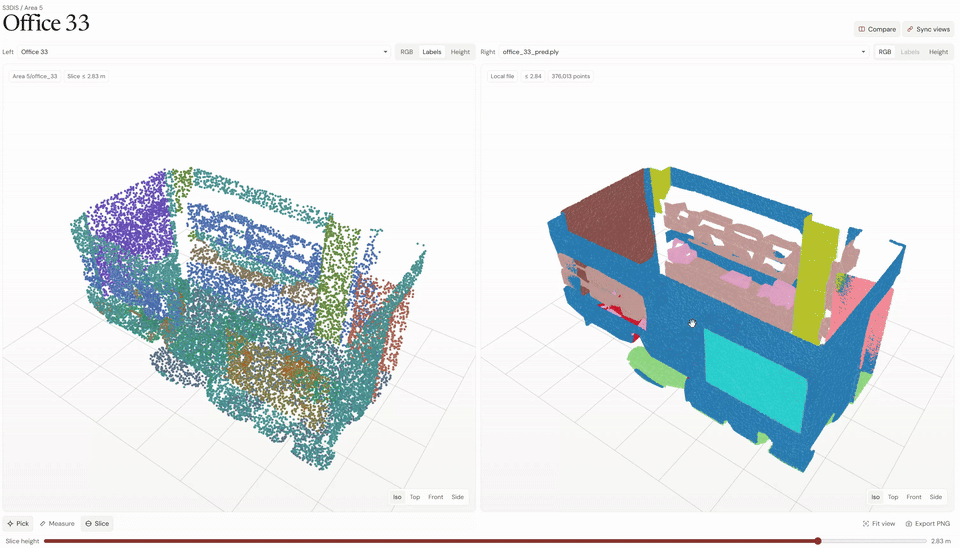

# A Study on Token Compression and Quantization for PTv3 Point Cloud Segmentation

<p align="center">
  <a href="https://huggingface.co/yubinux/PTv3-PTQ"></a>
</p>

### This project studies inference-time token merging and reduced-precision inference for Point Transformer V3 (PTv3) on S3DIS Area 5.

> This work was completed as a **course project**.

## Interactive Visualization

Explore and compare indoor point clouds in the browser with our course project's visualization platform. [Open LiDAR Workbench ↗](https://zhouxuan-git.github.io/lidar-workbench/?v=4)



## GitMerge3D Token Merging

The PTv3 integration adapts GitMerge3D's patch matching to merge similar tokens before attention and restore the original token layout afterward. The merge ratio and stride are configurable through `--r` and `--stride`.

## FP16 and INT8 Post-Training Quantization

- **FP16** runs a trained checkpoint in half precision without calibration.
- **INT8 (W8A8)** uses calibration data to set activation scales for linear layers and supported sparse convolutions, with per-output-channel INT8 weight quantization. The evaluator selects this path when given a `ptv3-w8a8-v1` checkpoint.

### Download Checkpoints

Run these commands from the repository root to download the published weights. The INT8 command saves the checkpoint to the evaluator's default `--int8` path. [Hugging Face files](https://huggingface.co/yubinux/PTv3-PTQ/tree/main)

```bash
python -m pip install huggingface_hub

model_dir=exp/s3dis/ptv3-area5/model
hf download yubinux/PTv3-PTQ model_best_fp16.pth --local-dir "$model_dir"
hf download yubinux/PTv3-PTQ ptv3_w8a8.pth --local-dir "$model_dir/quant"

# Optional FP32 checkpoint for the baseline and GitMerge3D evaluation.
hf download yubinux/PTv3-PTQ model_best.pth --local-dir "$model_dir"
```

## Evaluation

From the repository root, use a configured Pointcept environment, preprocessed S3DIS data with an `Area_5` directory, and compatible local checkpoints.

```bash
export POINTCEPT_PYTHON="$(command -v python)" NUM_GPUS=1
eval_script=scripts/test_ptv3_s3dis_area5.sh
sh "$eval_script" --data-root data/s3dis_le_1m --gitmerge3d --r 0.8 --stride 5
sh "$eval_script" --data-root data/s3dis_le_1m --fp16 --weight exp/s3dis/ptv3-area5/model/model_best_fp16.pth
sh "$eval_script" --data-root data/s3dis_le_1m --int8
```

For INT8, use a CUDA environment with spconv, Triton, and the CUDA toolkit available. `--int8` defaults to `exp/s3dis/ptv3-area5/model/quant/ptv3_w8a8.pth` when `--weight` is omitted. Add `--gitmerge3d --r 0.7 --stride 4` to evaluate INT8 with token merging.

### Visualize S3DIS Predictions

From the repository root, pass the experiment's `result/` directory to the [prediction exporter](tools/export_s3dis_predictions.py). This directory should contain files named `Area_5-<room>_pred.npy`. Use the same preprocessed `--data-root` as the evaluation so the predictions match the original room coordinates.

```bash
python tools/export_s3dis_predictions.py \
    /home/yy/pointcept-experiments/01-ptv3-baseline/result \
    --data-root data/s3dis_le_1m
```

Replace the example `result/` path with your own. The script writes one `<room>_pred.ply` file per room to `result/cloudcompare_ply/` by default. Use `--output-dir` to choose a different folder.

In CloudCompare, choose **File → Open** and select a generated `.ply` file. The RGB colors show the predicted semantic classes, and the `pred_label` field stores the class ID for each point. [CloudCompare PLY support](https://www.cloudcompare.org/doc/wiki/index.php/FILE_I/O)

### S3DIS Area 5 Results

| Method | Type | `r` | Stride | Patch size | mIoU | mAcc | allAcc | Throughput (Mpts/s/GPU) | Mean AGM (MiB) | Peak AGM (GiB) | Weight size (MiB) |
| :--- | :--- | ---: | ---: | ---: | ---: | ---: | ---: | ---: | ---: | ---: | ---: |
| **PTv3** | **Baseline** | — | — | 128 | **80.05%** | **84.65%** | **93.56%** | **1.0222** | **423.9** | **6.83** | **176.41** |
| PTv3 + RandomDrop | TC | 0.8 | — | 26 | 76.07%<br><sub>(-3.98 pp)</sub> | 81.48%<br><sub>(-3.17 pp)</sub> | 91.91%<br><sub>(-1.65 pp)</sub> | 0.7225<br><sub>(-29.32%)</sub> | 384.4<br><sub>(-9.32%)</sub> | 3.64<br><sub>(-46.71%)</sub> | 176.41<br><sub>(0.00%)</sub> |
| PTv3 + GitMerge3D | TC | 0.5 | 2 | 64 | 79.79%<br><sub>(-0.26 pp)</sub> | 84.35%<br><sub>(-0.30 pp)</sub> | 93.50%<br><sub>(-0.06 pp)</sub> | 0.7480<br><sub>(-26.82%)</sub> | 423.9<br><sub>(0.00%)</sub> | 6.55<br><sub>(-4.10%)</sub> | 176.41<br><sub>(0.00%)</sub> |
| PTv3 + GitMerge3D | TC | 0.7 | 4 | 39 | 79.73%<br><sub>(-0.32 pp)</sub> | 84.29%<br><sub>(-0.36 pp)</sub> | 93.41%<br><sub>(-0.15 pp)</sub> | 0.8088<br><sub>(-20.88%)</sub> | 423.9<br><sub>(0.00%)</sub> | 6.42<br><sub>(-6.00%)</sub> | 176.41<br><sub>(0.00%)</sub> |
| PTv3 + GitMerge3D | TC | 0.8 | 5 | 26 | 78.90%<br><sub>(-1.15 pp)</sub> | 83.42%<br><sub>(-1.23 pp)</sub> | 93.10%<br><sub>(-0.46 pp)</sub> | 0.8283<br><sub>(-18.97%)</sub> | 423.9<br><sub>(0.00%)</sub> | 6.37<br><sub>(-6.73%)</sub> | 176.41<br><sub>(0.00%)</sub> |
| PTv3 + GitMerge3D | TC | 0.9 | 10 | 13 | 76.87%<br><sub>(-3.18 pp)</sub> | 81.52%<br><sub>(-3.13 pp)</sub> | 92.22%<br><sub>(-1.34 pp)</sub> | 0.8816<br><sub>(-13.75%)</sub> | 423.9<br><sub>(0.00%)</sub> | 6.34<br><sub>(-7.17%)</sub> | 176.41<br><sub>(0.00%)</sub> |
| PTv3 FP16 | PTQ | — | — | 128 | 80.05%<br><sub>(0.00 pp)</sub> | 84.65%<br><sub>(0.00 pp)</sub> | 93.56%<br><sub>(0.00 pp)</sub> | 1.4035<br><sub>(+37.30%)</sub> | 237.9<br><sub>(-43.88%)</sub> | 5.51<br><sub>(-19.33%)</sub> | 88.27<br><sub>(-49.96%)</sub> |
| PTv3 INT8 | PTQ | — | — | 128 | 80.06%<br><sub>(+0.01 pp)</sub> | 84.67%<br><sub>(+0.02 pp)</sub> | 93.57%<br><sub>(+0.01 pp)</sub> | 1.2970<br><sub>(+26.88%)</sub> | 106.8<br><sub>(-74.81%)</sub> | 5.39<br><sub>(-21.08%)</sub> | 44.78<br><sub>(-74.62%)</sub> |
| PTv3 INT8 + GitMerge3D | TC + PTQ | 0.7 | 4 | 39 | 79.75%<br><sub>(-0.30 pp)</sub> | 84.32%<br><sub>(-0.33 pp)</sub> | 93.42%<br><sub>(-0.14 pp)</sub> | 0.9864<br><sub>(-3.50%)</sub> | 106.8<br><sub>(-74.81%)</sub> | 4.82<br><sub>(-29.43%)</sub> | 44.78<br><sub>(-74.62%)</sub> |
| PTv3 INT8 + GitMerge3D | TC + PTQ | 0.8 | 5 | 26 | 78.92%<br><sub>(-1.13 pp)</sub> | 83.46%<br><sub>(-1.19 pp)</sub> | 93.12%<br><sub>(-0.44 pp)</sub> | 1.0280<br><sub>(+0.57%)</sub> | 106.8<br><sub>(-74.81%)</sub> | 4.78<br><sub>(-30.01%)</sub> | 44.78<br><sub>(-74.62%)</sub> |

*Table 1. PTv3 semantic segmentation on S3DIS Area 5 with token compression, FP16 inference, and INT8 post-training quantization. Parentheses show the change from the bold PTv3 baseline. Accuracy changes are in percentage points (pp). Throughput, memory, and weight-size changes are relative percentages. A dash indicates that a parameter does not apply.*

The full experimental results will be available in the [PTv3-PTQ repository on Hugging Face](https://huggingface.co/yubinux/PTv3-PTQ/tree/main).

- **Method types.** TC stands for token compression. The post-training quantization (PTQ) group includes FP16 as an uncalibrated half-precision comparison and INT8 as calibrated W8A8, which quantizes both weights and activations in supported layers.
- **Compression parameters.** `r` is the target fraction of tokens merged within each GitMerge3D attention patch, or the fraction of input points dropped by RandomDrop before inference. GitMerge3D uses the stride as the bin width and selects one destination token per full bin. Patch size reports the token count for a full 128-token patch after GitMerge3D. For RandomDrop, 26 is the equivalent retained count out of 128 at `r = 0.8`. RandomDrop samples points per room before the model forms attention patches.
- **Segmentation metrics.** mIoU is the mean of per-class intersection-over-union scores. mAcc is the mean of per-class accuracies. allAcc is the fraction of all evaluated points classified correctly.
- **Efficiency metrics.** Throughput is measured in millions of model input points per second per GPU, using forward-pass time after five warm-up passes per GPU. AGM stands for allocated GPU memory. Mean AGM averages the allocation at the end of each timed forward pass. Peak AGM is the highest allocation recorded during a timed forward pass. Weight size is the on-disk size of the model weights.

## References and Acknowledgments

We thank the authors and maintainers of these projects for releasing their code.

- **Point Transformer V3 (PTv3)** for the segmentation backbone. [GitHub repository](https://github.com/Pointcept/PointTransformerV3)
- **Pointcept** for the point cloud training and evaluation framework. [GitHub repository](https://github.com/Pointcept/Pointcept)
- **GitMerge3D** for the token merging method and reference implementation. [GitHub repository](https://github.com/anhtuanhsgs/GitMerge3D)
